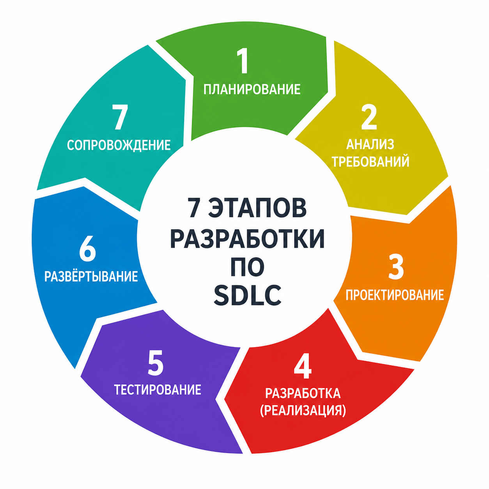

# Жизненный цикл разработки программного обеспечения (Software Development Life Cycle, SDLC)

Это структурированный процесс создания программного продукта от появления первой идеи до его полного вывода из эксплуатации. Он включает последовательные этапы, которые помогают организовать работу, контролировать качество и планировать развитие ПО.



## Основные этапы SDLC

---

### 1. Этап планирования (Planning)
Этот этап закладывает фундамент всего проекта. Основная цель фазы планирования — понять, стоит ли вообще начинать разработку и можно ли ее реализовать в рамках имеющихся ресурсов.

Стартовая команда (руководитель проекта, стейкхолдеры, архитектор) проводит анализ бизнес-целей, оценивает рыночную потребность, формирует предварительный бюджет, календарный план и примерный состав расширенной команды.

Уже здесь выявляются основные риски, ограничения по срокам, требованиям и технологиям. Отдельные пункты могут потребовать проведения исследований и технико-экономического обоснования — для понимания вопроса «Можно ли сделать продукт с заданными характеристиками и/или ценой?».

**Ключевые документы этапа:** устав проекта, дорожная карта (roadmap), примерная смета, список рисков и план управления ими.

На этом этапе решается судьба проекта: очень много стартапов закрывается именно здесь, потому что выявляется их нецелесообразность. Правильное планирование снижает риск системных ошибок, таких как превышение бюджета, недооценка сроков и т.п. Уже здесь можно определить подходящую модель разработки: каскадный Waterfall, гибкий подход Agile (итеративный подход) или гибрид. От методологии управления будут зависеть все последующие процессы.

*Без четкого планирования дальнейшие этапы превращаются в хаос.*

**Роль SA на этом этапе:**
- Участвует в технико-экономическом обосновании (feasibility study)
- Оценивает сложность интеграций с существующими системами
- Проводит предварительный анализ AS-IS (как работает сейчас)
- Выявляет технические ограничения и риски архитектуры
- Помогает оценить трудозатраты на аналитику в проекте

**Артефакты SA:**
- Отчет о технической осуществимости
- Список систем-участников интеграции
- Предварительная оценка сложности (T-shirt sizing: S/M/L/XL)

**Почему это важно:** SA помогает избежать ситуации, когда бизнес обещает "простую фичу за неделю", а на деле это требует перестройки всей архитектуры.

---

### 2. Этап сбора и анализа требований (Requirements Gathering & Analysis)
Самый критичный этап: многие ошибки в проектах возникают именно из-за неправильно понятых стартовых требований.

Бизнес-аналитики, владелец продукта и стейкхолдеры проводят интервью, исследования, анкетирование пользователей, анализ конкурентов и существующих систем (продуктов конкурентов). Требования делятся на:
- **функциональные** — что система должна делать;
- **нефункциональные** — производительность, безопасность, масштабируемость, доступность.

Все документируется в виде пользовательских историй (User Stories), кейсов использования (Use Cases), спецификаций (SRS, Software Requirements Specification), бэклога или документа бизнес-требований (BRD, Business Requirements Document).

Обязательно проводится приоритизация и валидация требований с заказчиком. Для этого могут пригодиться методы: MoSCoW, Кано, WSJF, RICE и другие. Если элементов слишком много, то создается матрица прослеживаемости (traceability matrix), чтобы каждое требование можно было отследить вплоть до стадии написания кода и тестирования.

```
Согласно "Правилу 1:10:100" (Стоимость ошибки):
На этапе проектирования: 10 рублей
На этапе разработки: 100 рублей
На этапе тестирования: 1 000 рублей
На продакшене: 10 000 рублей
```

**Наиболее значимые риски этапа:** размытые требования, слишком дорогие фичи, конфликты между стейкхолдерами. Если пропустить этот этап, стоимость исправления ошибки на поздних стадиях вырастает кратно.

По окончании этапа заказчик подписывает документ с требованиями, который становится юридической основой контракта.

**Роль SA на этом этапе:**
- Проводит интервью со стейкхолдерами
- Декомпозирует бизнес-требования на функциональные/нефункциональные
- Пишет User Stories и Use Cases
- Создает матрицу трассируемости требований
- Валидирует требования с заказчиком

**Артефакты SA:**
- User Stories с Acceptance Criteria
- Use Case спецификации
- SRS (Software Requirements Specification)
- Матрица трассируемости требований

**Почему это важно:** Это основной этап для SA. Ошибки здесь стоят дешевле всего, но влияют на весь проект.

---

### 3. Этап проектирования (Design)
Этот этап позволяет командам перейти из состояния «что делать» в «как делать» — тут создаются предметные схемы будущего продукта и его подсистем.

Архитекторы и ведущие разработчики проектируют высокоуровневую архитектуру продукта: что будет использоваться для создания программного обеспечения, какие паттерны и структуры, решают, будет ли это система на основе микросервисов или монолита, какие и где будут базы данных, будут ли задействоваться API-интерфейсы и интеграции.

UX/UI-дизайнеры создают наброски (упрощенные прототипы) интерфейса программы. Системный аналитик проектирует технические спецификации, ER-диаграммы, UML, последовательности вызовов, механизмы безопасности и масштабирования на случай пикового роста нагрузки.

**Артефакты этой стадии жизненного цикла:** макеты интерфейсов, схемы связей ключевых элементов и подсистем продукта, API-спецификации, инфраструктурная схема (IaC).

**Роль SA на этом этапе:**
- Проектирует REST/gRPC API контракты
- Создает ER-диаграммы и модели данных
- Рисует UML Sequence Diagrams для сложных сценариев
- Описывает интеграции (синхронные через REST, асинхронные через Kafka/RabbitMQ)
- Согласовывает технические решения с архитектором

**Артефакты SA:**
- OpenAPI/Swagger спецификации
- ER-диаграммы базы данных
- UML Sequence/Activity диаграммы
- Описание интеграционных контрактов
- Постановки на разработку для Backend/Frontend

**Почему это важно:** Разработчики получают четкую спецификацию и могут писать код без постоянных вопросов "а как это должно работать?".

---

### 4. Стадия реализации / создания программного обеспечения (Implementation / Coding)
На этом этапе все визуальные схемы и макеты превращаются в реально работающий код.

Разработчики создают программный продукт: пишут функции и модули по утвержденным спецификациям, параллельно настраивается CI/CD-пайплайн — автоматическая сборка, unit-тесты, статический анализ.

Frontend- и backend-программисты, системные администраторы, DevOps-инженеры работают одновременно в спринтах (при гибкой методологии) или последовательно (если используется каскадная модель).

Параллельно организуется документирование кода и создание технической документации продукта для передачи клиенту или для специалистов поддержки.

**Ключ к успеху** — чистый читаемый код, покрытый тестами.

**Самые существенные риски стадии:** накопление технического долга и вынужденное изменение архитектуры. Последнее обходится дороже всего.

**Роль SA на этом этапе:**
- Отвечает на вопросы разработчиков по требованиям
- Уточняет edge cases (граничные случаи)
- Принимает решения при обнаружении противоречий в ТЗ
- Обновляет документацию при изменениях
- Участвует в code review (опционально, проверяет соответствие API контрактам)

**Артефакты SA:**
- Обновленные спецификации (если были изменения)
- Ответы в Jira/Confluence на вопросы команды
- Протоколы технических решений (ADR - Architecture Decision Records)

**Почему это важно:** SA выступает "живой документацией" — когда разработчик не понимает, как должна работать фича, он идет к SA, а не к бизнесу.

---

### 5. Тестирование (Testing & QA)
Этап, на котором проверяется, соответствует продукт требованиям и ожиданиям стейкхолдеров или нет. Обычно тут в дело вступают тестировщики (QA, QE, SDET) — они выполняют несколько уровней тестирования:

- Unit-тесты (автоматические)
- Интеграционные
- Системные
- Приемочные (UAT)
- Нагрузочный и стресс-тест, устойчивость к взломам (penetration testing), проверка юзабилити.

Баг-трекинг ведется в специальных программах или в хранилищах кода.

Без качественного тестирования даже идеально написанный код может провалиться в продакшене. Этот этап часто занимает около трети времени всего проекта и позволяет обнаружить большинство дефектов и проблем до релиза.

**Роль SA на этом этапе:**
- Помогает QA писать тест-кейсы на основе требований
- Разъясняет критерии приемки (Acceptance Criteria)
- Участвует в приемочном тестировании (UAT)
- Проверяет, что найденные баги действительно являются багами, а не "ожидаемым поведением"
- Приоритизирует баги с точки зрения бизнес-ценности

**Артефакты SA:**
- Тестовые данные для QA
- Разъяснения по требованиям для тестировщиков
- Решения о том, является ли поведение системы багом или фичей

**Почему это важно:** QA может найти "баг", который на самом деле является ожидаемым поведением. SA помогает различить реальную ошибку от недопонимания требований.

---

### 6. Развертывание / Внедрение (Deployment / Release)
После завершения тестирования продукт попадает к реальным пользователям. Именно здесь облачные сервисы разворачиваются в соответствующей инфраструктуре, а stand-alone продукты передаются заказчикам для проверки или публикуются в маркетплейсах.

На этом этапе тоже могут использоваться специфичные инструменты и подходы, например, сбор данных через системы аналитики, вывод ключевых данных о работе программы в дашборд и прочее.

В некоторых случаях в этап сдачи может входить обучение пользователей, помощь с миграцией данных, вывод из эксплуатации старой информационной системы, исправление багов и недочетов, которые выявил заказчик или реальные пользователи.

**Ошибки на этом этапе самые заметные.** Обычно они выражаются в «падении» сервиса под нагрузкой, в потере данных клиентов, а также в виде негативных отзывов и оценок на маркетплейсах.

**Роль SA на этом этапе:**
- Готовит релизные заметки (Release Notes)
- Проводит демо для стейкхолдеров
- Обучает команду поддержки новым фичам
- Участвует в UAT (User Acceptance Testing) с заказчиком
- Фиксирует приемку функционала

**Артефакты SA:**
- Release Notes
- Презентация для демо
- Инструкция для поддержки (FAQ, troubleshooting)
- Акт приемки функционала (подписанный заказчиком)

**Почему это важно:** SA переводит технический релиз на язык бизнеса — объясняет, что именно было сделано и какую ценность это принесло.

---

### 7. Эксплуатация и сопровождение (Maintenance & Support)
Эта стадия жизненного цикла SDLC в норме существенно дольше по времени, чем все остальные стадии разработки. В поддержку клиентов обычно включают следующие задачи:

- исправление багов;
- плановые обновления;
- добавление новой функциональности;
- мониторинг производительности и безопасности;
- масштабирование и балансировка нагрузки;
- обновление / актуализация базы знаний, а также документации по продукту;
- вывод из эксплуатации.

Именно на этом этапе окупаются инвестиции в разработку приложения или сервиса. Но здесь же таится и большая часть расходов, связанных с сопровождением.

Проект обычно закрывается, если перестает приносить ценность конечным пользователям. Фаза закрытия тоже может иметь свои нюансы: нужно заранее оповестить клиентов, помочь им с миграцией и сохранением данных, закрыть все обязательства перед партнерами и поставщиками.

**Роль SA на этом этапе:**
- Анализирует инциденты на продакшене
- Выявляет системные проблемы (не просто баги, а архитектурные недостатки)
- Планирует улучшения и рефакторинг
- Обновляет документацию по мере эволюции системы
- Участвует в разборе post-mortem после инцидентов

**Артефакты SA:**
- Анализ инцидентов (Root Cause Analysis)
- Бэклог технических улучшений
- Обновленная документация системы
- Отчеты о производительности и узких местах

**Почему это важно:** SA видит систему в долгосрочной перспективе и может предложить системные улучшения, а не просто "латание дыр".

---

## 📊 Сводная таблица: SA на всех этапах SDLC

| Этап SDLC          |   Основная задача SA   |      Ключевые артефакты      |
|:-------------------|:----------------------:|:----------------------------:|
| **Planning**       | Оценка осуществимости  |      Feasibility report      |
| **Requirements**   |  Сбор и формализация   |      User Stories, SRS       |
| **Design**         | Проектирование решений |   API specs, ER-диаграммы    |
| **Implementation** |  Поддержка разработки  |    Ответы на вопросы, ADR    |
| **Testing**        |   Валидация качества   | Тест-кейсы, решения по багам |
| **Deployment**     |     Приемка и демо     |  Release Notes, акт приемки  |
| **Maintenance**    |   Анализ и улучшения   |    RCA, бэклог улучшений     |

---

## 💡 Совет для собеседования

Когда на собеседовании спросят: **"Что вы делали на этапе X?"**, используй формулу:

> **"На этапе [название] я как SA [основная задача]. Конкретно я [2-3 действия]. Результатом было [артефакт/ценность]."**

**Пример:**
> "На этапе проектирования я как SA проектировал технические решения. Конкретно я создал Swagger-спецификацию для 15 эндпоинтов API, нарисовал Sequence Diagram для процесса оплаты и согласовал архитектуру с командой. Результатом было то, что разработчики написали код без единого вопроса по контрактам API."

---

## Государственные стандарты и официальные нормы разработки ПО

В международной и российской практике фазы SDLC формализованы через стандарты системной и программной инженерии. Они не навязывают конкретную модель разработки, а лишь описывают набор наиболее важных процессов — без которых разработка невозможна.

- **Международные стандарты:** ISO/IEC/IEEE 12207, ISO/IEC/IEEE 15288.
- **Российские стандарты:** ГОСТ Р ИСО/МЭК 12207-2010, ГОСТ Р 57193-2016 (аналог ISO 15288), ГОСТ Р 56923-2016, а также ГОСТ 34.601-90 (уже устаревший).

Все они описывают одни и те же принципы и придерживаются процессного подхода, когда в жизненном цикле может быть любое количество фаз и стадий, но все они делятся на группы:

1. **Соглашения** — касаются процесса обсуждения требований и приобретения ПО.
2. **Процессы оргобеспечения** — управление жизненным циклом разработки, организацией инфраструктуры, портфелями проектов, качеством и т.п.
3. **Процессы проекта** — все, что относится к реализации отдельного проекта.
4. **Технические процессы** — очень похожи на предметные стадии SDLC, которые мы описали выше, но только в разрезе реализации комплексной системы.

Особого внимания стоят специальные процессы, которые нужны для:
- реализации программных средств;
- технической поддержки и сопровождения программ;
- повторного использования / применения программ.

---

## Какие существуют модели SDLC

Наиболее популярные модели SDLC напрямую связаны с концепциями управления.

### 1. [[Waterfall]] (каскадная модель)
Классический SDLC цикл — линейная модель или каскад. Все этапы идут строго последовательно. Идеально подходит для проектов с жестко зафиксированными требованиями, где изменения минимальны: государственные системы, медицинское ПО, военные и банковские программные комплексы.

- **Преимущества:** четкая структура, стабильная и хорошо детализированная документация, предсказуемые сроки и бюджет.
- **Недостатки:** очень дорого и сложно вносить изменения после запуска процесса создания ПО, минимальная гибкость, позднее обнаружение проблем.

### 2. V-Model (V-образная модель)
Расширение Waterfall с акцентом на тестирование. Каждый этап разработки имеет соответствующий уровень тестирования: unit-, интеграционное и т.д. Завершается все приемочным тестом. Применяется в проектах, где качество и стандартизация предельно критичны: медицина, автомобили, авиация, железнодорожные системы, оборонные системы.

- **Плюсы:** встроенная проверка на каждом уровне, высокая надежность, гарантия полного соответствия исходным требованиям.
- **Минусы:** все та же жесткость «водопада», максимальные сроки реализации.

### 3. Гибкая разработка (Agile)
Итеративно-инкрементный подход, основанный на Манифесте Agile 2001 года. Разработка идет короткими циклами, например, спринтами по 1-4 недели, с постоянной обратной связью от заказчика, с приоритизацией бэклога и адаптацией к изменениям. Основные фреймворки: Scrum, Kanban, SAFe, LeSS.

Доминирует в продуктовых и IT-компаниях — в бизнес-сегменте. Идеален для стартапов, облачных сервисов, мобильных приложений с часто меняющимися требованиями.

- **Преимущества:** быстрое создание ценности для конечных пользователей, высокая адаптивность, минимальный риск провала (так как проект пересматривается и адаптируется на каждой итерации).
- **Недостатки:** требует зрелой команды, активного участия заказчика, может привести к «вечному улучшению» без четких целей.

### 4. Spiral (Спиральная модель)
Вариант итеративной модели с сильным акцентом на управление рисками. Каждый виток спирали включает 4 фазы: планирование, анализ рисков, разработка прототипа, оценка. После очередного витка принимается решение — продолжать, менять или останавливать проект. Такой подход будет интересен для крупных и сложных проектов, например для enterprise-систем.

- **Плюсы:** раннее выявление и минимизация рисков, возможность отказаться от заведомо провального направления, качественные прототипы для проверки гипотез (MVP-модель).
- **Минусы:** дорого и долго, практически нереально спрогнозировать финальные сроки и бюджет, требует опытных риск-менеджеров.

### 5. Incremental (Инкрементальная модель)
ПО разрабатывается и сдается частями — инкрементами. Каждый инкремент — это полноценная, работающая подсистема, добавляющая новую функциональность к предыдущим. Этапы внутри инкремента могут соответствовать разным подходам, в том числе и каскадному.

- **Преимущества:** относительно быстрые запуск продукта, поэтапное финансирование и наращивание функционала, проще управлять рисками.
- **Недостатки:** нужно правильно спроектировать архитектуру, чтобы инкременты стыковались без переделок.

### 6. DevOps / Continuous Delivery / DevSecOps
Оригинальный подход к разработке, где различные модули реализуются как независимые системы и подсистемы, а связи настраиваются по API. В этом случае разработкой каждого блока может заниматься отдельная команда, а в своей работе она может использовать любую методологию управления, язык программирования и архитектурные решения. Тем не менее разработка, тестирование, обеспечение безопасности и операции легко объединяются в единый непрерывный процесс. Это современный стандарт де-факто для высоконагруженных SaaS-продуктов.

- **Преимущества:** максимальная скорость доставки обновлений без остановки работы всей системы, высокая надежность, встроенная безопасность и мониторинг.
- **Минусы:** требует серьезных инвестиций в разработку исходной архитектуры и согласование деталей взаимодействия подсистем — в разработку API.

---

```
Разные модели часто комбинируют между собой: Agile + DevOps, Waterfall с элементами итераций, спиральная модель внутри крупных Agile-проектов и т.д. 
Реальный выбор подхода зависит от размера проекта, уровня неопределенности, входящих требований и зрелости команды.
В российских энтерпрайзах (Сбер, ВТБ, Ростелеком) часто используется гибридная модель:
  - Верхний уровень (бюджетирование, контракты) — Waterfall
  - Нижний уровень (разработка внутри спринтов) — Scrum
Это называется Water-Scrum-Fall или Hybrid Agile.
```

## 🚨 Уроки из реальных провалов в разработке ПО

> Эти кейсы показывают, что неправильный выбор модели SDLC или нарушение процессов может стоить миллионы долларов, репутацию компании и даже человеческие жизни.

---

## 1. 💥 Healthcare.gov (2013) — Провал Waterfall

### 📋 Описание проекта
- **Что:** Портал медицинского страхования США (Obamacare)
- **Бюджет:** $634 млн (изначально $93 млн)
- **Срок:** 3 года разработки
- **Модель:** Waterfall с жесткими контрактами

### ❌ Что пошло не так
- **2 года разрабатывали без обратной связи с пользователями**
- Требования были зафиксированы в самом начале и не менялись
- 55 различных подрядчиков работали изолированно
- Интеграционное тестирование началось за **2 недели до релиза**
- Сайт не был протестирован под нагрузкой

### 📉 Последствия
- **День запуска:** сайт падал под нагрузкой 1% пользователей
- Только **1%** первых пользователей смогли завершить регистрацию
- Потеряно **$400+ млн** на исправления
- Политический скандал федерального уровня

### 💡 Уроки
| Урок | Применение |
|------|-----------|
| Для сложных пользовательских систем нужен **Agile с ранними MVP** | Тестируй с реальными пользователями как можно раньше |
| Интеграционное тестирование должно начинаться **за месяцы**, а не за недели | Встраивай CI/CD с первого дня |
| 55 подрядчиков без координации = катастрофа | Один архитектор/лид должен видеть всю картину |

---

## 2. ✈️ Boeing 737 MAX (2018-2019) — Нарушение V-Model

### 📋 Описание проекта
- **Что:** Обновление системы управления самолетом (MCAS)
- **Бюджет:** $20+ млрд убытков
- **Модель:** V-Model (формально), но с критическими нарушениями

### ❌ Что пошло не так
- **Скрытые изменения:** Система MCAS была добавлена без полного документирования
- **Недостаточное тестирование:** Пилоты не были проинформированы о новой системе
- **Экономия на безопасности:** Один датчик угла атаки вместо двух (для экономии $250,000 на самолет)
- **Давление менеджмента:** Конкуренция с Airbus A320neo заставила ускорить релиз
- **Регуляторные провалы:** FAA делегировало сертификацию самому Boeing

### 📉 Последствия
- **2 катастрофы:** Lion Air (2018) и Ethiopian Airlines (2019)
- **346 погибших**
- **$20+ млрд убытков** (запрет полетов на 20 месяцев)
- Репутационный ущерб на десятилетия

### 💡 Уроки
| Урок | Применение |
|------|-----------|
| V-Model требует **жесткого следования** каждому этапу тестирования | Нельзя пропускать интеграционное и приемочное тестирование |
| **Изменения в критических системах** требуют полного цикла ревью | Любое изменение в требованиях → новый цикл тестирования |
| **Резервирование** критических компонентов обязательно | Один датчик угла атаки = точка отказа |
| Безопасность **не может быть** предметом торга с бизнесом | Экономия $250,000 стоила $20 млрд |

---

## 3. 🏦 Knight Capital Group (2012) — Провал деплоя

### 📋 Описание проекта
- **Что:** Обновление алгоритмической торговой системы
- **Бюджет:** Потеряно $460 млн за 45 минут
- **Модель:** Отсутствовала (хаотичный деплой)

### ❌ Что пошло не так
- **Человеческая ошибка:** Инженер забыл обновить один из 8 серверов
- **Отсутствие чек-листа:** Не было формального процесса проверки деплоя
- **Отсутствие отката:** Не было возможности быстро вернуться к предыдущей версии
- **Мертвый код:** Старая функция "Power Peg" была удалена из интерфейса, но не из кода

### 📉 Последствия
- **$460 млн убытков за 45 минут** ($10 млн в минуту)
- Компания обанкротилась и была продана за $10 млн
- 400+ сотрудников потеряли работу

### 💡 Уроки
| Урок | Применение |
|------|-----------|
| **Чек-листы деплоя** обязательны для критических систем | Даже гении ошибаются |
| **Откат (rollback)** должен быть мгновенным | Если что-то пошло не так, вернись за секунды |
| **Мертвый код** нужно удалять полностью | Незаконченные фичи = мины замедленного действия |
| **Мониторинг в реальном времени** критичен | $10 млн/минуту можно было остановить за 5 минут |

---

## 4. 🏥 NHS National Programme for IT (Великобритания, 2002-2011)

### 📋 Описание проекта
- **Что:** Национальная система здравоохранения — единая электронная медкарта
- **Бюджет:** £12.4 млрд (изначально £6.2 млрд)
- **Срок:** 10 лет (закрыт досрочно)
- **Модель:** Waterfall с жестким контрактом

### ❌ Что пошло не так
- **Требования сверху:** Правительство фиксировало требования без консультаций с врачами
- **Отсутствие итераций:** 5 лет разрабатывали без показа результата пользователям
- **Политическое давление:** Проект продвигали ради пиара, а не ценности
- **Игнорирование фидбека:** Врачи и медсестры жаловались, но их не слушали

### 📉 Последствия
- **£12.4 млрд потрачено** без работающей системы
- Проект закрыт досрочно в 2011
- Крупнейший провал государственного ИТ-проекта в истории Европы

### 💡 Уроки
| Урок                                                 | Применение                                            |
|------------------------------------------------------|-------------------------------------------------------|
| **Пользователи должны быть вовлечены** с первого дня | Врачи, а не чиновники, должны валидировать требования |
| **Короткие итерации** вместо "большого взрыва"       | Показывай результат каждые 2-4 недели                 |
| **Гибкость важнее контракта**                        | Если требования изменились, нужно адаптироваться      |

---

## 5. ✈️ F-35 Lightning II (1996-настоящее время) — Проклятие Waterfall

### 📋 Описание проекта
- **Что:** Истребитель 5-го поколения для США и союзников
- **Бюджет:** $1.7 трлн (самый дорогой военный проект в истории)
- **Срок:** 25+ лет (изначально планировалось 10)
- **Модель:** Waterfall с фиксированными требованиями

### ❌ Что пошло не так
- **Требования зафиксированы в 1996 году** — до того, как стали понятны реальные технологии
- **Конкурирующие требования:** ВВС, ВМС и Морпехи хотели разные версии одного самолета
- **Отсутствие итераций:** Нельзя было изменить требования без переписывания контрактов
- **Технический долг:** Проблемы с ПО копятся десятилетиями

### 📉 Последствия
- **$1.7 трлн** общих затрат (включая обслуживание до 2088 года)
- **25+ лет** разработки без финального релиза
- Тысячи нерешенных багов в ПО

### 💡 Уроки
| Урок | Применение |
|------|-----------|
| **Нельзя фиксировать требования** на 25 лет вперед | Мир меняется быстрее, чем разрабатывается система |
| **Разные стейкхолдеры** = разные требования | Не пытайся сделать "один продукт для всех" |
| **Инкрементальная поставка** вместо "всё сразу" | Выпускай работающие версии, а не жди идеала |

---

## 6. 🏢 Denver International Airport (1995) — Автоматизация без тестирования

### 📋 Описание проекта
- **Что:** Автоматическая система обработки багажа
- **Бюджет:** $4.8 млрд (превышение на $2 млрд)
- **Срок:** 16 месяцев задержки
- **Модель:** Waterfall без адекватного тестирования

### ❌ Что пошло не так
- **Недооценка сложности:** 500+ компьютеров, 90 миль рельсов, 300+ тележек
- **Отсутствие интеграционного тестирования:** Каждую тележку тестировали отдельно, но не всю систему вместе
- **Жесткие сроки:** Открытие было назначено политической датой, а не технической готовностью
- **Нет плана Б:** Если автоматика не работает, ручная обработка багажа не была предусмотрена

### 📉 Последствия
- **16 месяцев задержки** открытия аэропорта
- **$2 млрд** перерасхода
- **$1.1 млн в день** убытков во время задержки
- Система так и не заработала полностью — в итоге перешли на ручную обработку

### 💡 Уроки
| Урок | Применение |
|------|-----------|
| **Интеграционное тестирование** критично для сложных систем | 100 работающих частей ≠ 1 работающая система |
| **Дедлайны от политики** ≠ технические дедлайны | Система не готова, потому что мэр сказал "открываем в мае" |
| **План Б** обязателен для критических систем | Что делаем, если автоматика упала? |

---

## 📊 Сводная таблица провалов

| Проект | Модель | Потери | Главный урок |
|--------|--------|--------|--------------|
| **Healthcare.gov** | Waterfall | $400 млн | Тестируй с пользователями рано |
| **Boeing 737 MAX** | V-Model (нарушен) | $20 млрд + 346 жизней | Безопасность > бизнес |
| **Knight Capital** | Нет модели | $460 млн / 45 мин | Чек-листы и откат обязательны |
| **NHS IT (UK)** | Waterfall | £12.4 млрд | Вовлекай пользователей с первого дня |
| **F-35** | Waterfall | $1.7 трлн | Не фиксируй требования на 25 лет |
| **Denver Airport** | Waterfall | $2 млрд | Интеграционное тестирование критично |

---

## 🎯 Выводы для системного аналитика

### ✅ Что делать правильно:
1. **Выбирай модель под проект**, а не под привычку
2. **Вовлекай пользователей** с первого дня (не только в конце)
3. **Интеграционное тестирование** начинай как можно раньше
4. **Документируй изменения** в требованиях (особенно в критических системах)
5. **Имей план Б** для критических систем

### ❌ Чего избегать:
1. **Не фиксируй требования** на годы вперед без возможности изменений
2. **Не экономь на тестировании** ради скорости
3. **Не игнорируй фидбек** пользователей и команды
4. **Не открывай проект**, потому что "начальство сказало"
5. **Не пропускай этапы** ради дедлайна

---


## 📱 Проект А: Мобильное приложение для доставки еды (стартап, нужно быстро запустить MVP, требования постоянно меняются)

### Ответ:
- Какая модель SDLC подходит? - Для стартапа лучше всего подойдет **Scrum** с короткими спринтами (1-2 недели), чтобы быстро получать обратную связь от пользователей.


- Почему именно эта? - **Обоснование:** подходит при частой смене требований.


- Какие риски нужно учесть? - **Риски:**
- **Scope creep (расползание скоупа):** без жесткого Product Owner бэклог может бесконечно расти;
- **Технический долг:** в погоне за скоростью команда может писать "грязный" код, который потом дорого рефакторить;
- **Burnout команды:** постоянные дедлайны спринтов могут выжечь разработчиков.

**Пример из жизни:** Многие food-delivery стартапы (Яндекс.Еда, Delivery Club в начале) начинали с Agile + MVP, быстро итерировали и захватили рынок.

---

## ☢️ Проект Б: Система управления атомной электростанцией

### Ответ:
- Какая модель SDLC подходит? - **V-model**


- Почему именно эта? - **Обоснование:** - это **расширение Waterfall**, где каждый этап разработки имеет **соответствующий уровень тестирования**:
```
Requirements ← → Acceptance Testing
Design ← → System Testing
Architecture ← → Integration Testing
Code ← → Unit Testing
```
- Какие риски нужно учесть? - **Риски:**
   - **Высокая стоимость:** V-model требует огромных ресурсов на документацию и тестирование;
   - **Длительность:** проект может занять 5-10 лет до первого релиза;
   - **Устаревание требований:** пока 5 лет пишут ТЗ и тестируют, технологии могут устареть.


- **Дополнительные модели для критических систем:**
- **Spiral (Спиральная)** — если есть высокая неопределенность в требованиях
- **Formal Methods** — математическая верификация кода (используется в авионике, ядерной энергетике)

**Реальный пример:** Системы управления АЭС часто используют комбинацию V-model + Formal Methods, где критический код доказывается математически.

---

## 🏦 Проект В: CRM-система для крупного банка

### Ответ:
- Какая модель SDLC подходит? - **Hybrid Agile (Water-Scrum-Fall)**


- Почему именно эта? - **Обоснование:**
  - **Верхний уровень (Waterfall):** бюджет, сроки, контракт с заказчиком — все фиксировано;
  - **Нижний уровень (Scrum):** разработка внутри спринтов гибкая, можно адаптироваться.


- **Структура Hybrid в банке:**
```
Годовой бюджет (Waterfall)
↓
Квартальные релизы (Waterfall milestones)
↓
Двухнедельные спринты (Scrum)
↓
Ежедневные стендапы (Scrum)
```
- Какие риски нужно учесть? - **Риски:**
  - **Конфликт методологий:** бизнес требует "железный" план, а команда работает гибко — возникает напряжение
  - **Иллюзия контроля:** менеджмент думает, что все под контролем (Waterfall), но реальность меняется (Agile)
  - **Сложность координации:** 10 команд работают в Scrum, но интеграция между ними требует Waterfall-планирования

 
- **Альтернативные подходы:**
  - **Waterfall с итерациями:** классический каскад, но с промежуточными демо каждые 3 месяца
  - **SAFe (Scaled Agile Framework):** фреймворк для масштабирования Agile на крупные энтерпрайзы

**Реальный пример:** Сбер, ВТБ, Тинькофф используют Hybrid — на уровне портфеля проектов Waterfall, на уровне команд Scrum.

---


